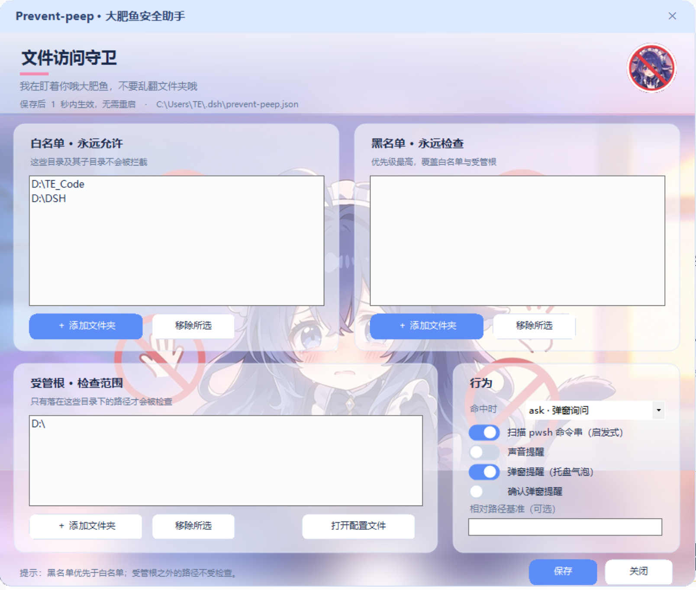

# Prevent-peep · 大肥鱼文件夹防窥眼罩

[English](README.md) | [简体中文](README.zh.md)

A path guard for **DeepSeek Harness**. Before any file tool runs, it checks the target
path against your allowlist — and pops an alert instead of silently reading your
private folders.



## Why

DSH agents can read anything your Windows user can read. This plugin puts a gate in
front of that: the tool is intercepted **before dispatch**, so a denied call never
touches the disk.

## Features

- **Pre-dispatch interception** via the `tools/pre-execute` waterfall — not a prompt
  instruction, the model cannot talk its way past it.
- **Three lists**
  - *Allow list* — always permitted
  - *Deny list* — always checked (wins over the allow list)
  - *Enforced roots* — only paths under these roots are policed
- **Four independent alerts**, each with its own switch: system sound, self-drawn
  silent notification window, Windows tray balloon (carries its own system sound),
  and a modal confirmation dialog.
- **Folder picker UI** with a native “select folder” dialog. Changes autosave and take
  effect within a second — no restart.
- **Global scope** — one config file for every workspace, session and subagent.
- Covers `read`, `write`, `edit`, `glob`, `grep`, `read_image`, `present`,
  `working_directory`, plus the `workdir` argument of `pwsh`.

## Install

Requires DSH with a `desktop` (or `web`) profile.

```sh
git clone <this repo> prevent-peep
dsh plugin --profile desktop add "<path>/bundle"
dsh plugin --profile desktop add "<path>/plugin"
```

Both packages are needed: `prevent-peep` is the bundle (what the plugin manager shows),
`prevent-peep-plugin` is the implementation it mounts. Restart DSH once afterwards.

## Usage

Double-click the launcher in `prevent-peep-plugin/`:

```
大肥鱼我真该控制你了！.cmd
```

It opens a small window where you can add or remove folders, toggle the four alerts,
and switch between `ask` (prompt) and `deny` (block silently).

Settings land in `%USERPROFILE%\.dsh\prevent-peep.json`:

```json
{
  "mode": "ask",
  "enforceRoots": ["D:\\"],
  "allowRoots": ["D:\\TE_Code", "D:\\DSH"],
  "denyRoots": [],
  "scanShell": true,
  "alertSound": true,
  "alertCustom": true,
  "alertToast": false,
  "alertPopup": true
}
```

| Key | Meaning |
| --- | --- |
| `mode` | `ask` pops the approval card, `deny` fails the call |
| `allowRoots` | always allowed |
| `denyRoots` | always checked (highest priority) |
| `enforceRoots` | only paths here are policed |
| `scanShell` | also scan `pwsh` command strings for enforced roots |
| `alertSound` | play a single ding |
| `alertCustom` | silent self-drawn notification window |
| `alertToast` | native Windows tray balloon (has its own sound) |
| `alertPopup` | modal confirmation dialog (silent) |

Resolution order: **deny → allow → enforced root**.

## Limitations

- The `pwsh` check is **heuristic**: it matches the enforced root as a literal in the
  command string. Paths assembled at runtime (`"D:" + "\foo"`) get through.
- Relative paths are only evaluated when they contain `..`; plain relative paths are
  assumed to stay inside the workspace.
- This is a guard rail, not a sandbox. For real confidentiality use ACLs, an encrypted
  container, or a separate Windows account.

## Assets

`prevent-peep-plugin/assets/` holds the runtime artwork: window background, avatar and
the `.ico` used by the desktop shortcut. They are crops of an AI-generated illustration —
replace them if you redistribute the plugin.

## Development

```sh
node prevent-peep-plugin/test/guard.test.mjs
```

## License

MIT